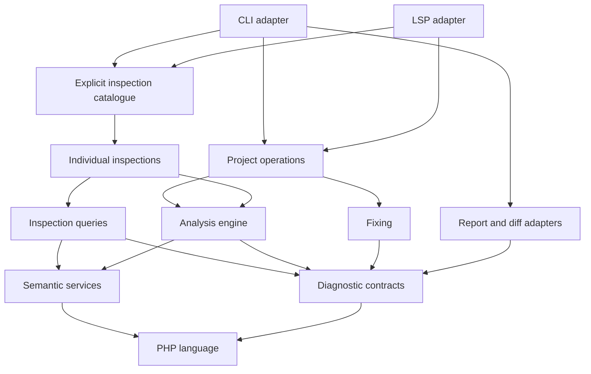

# Architecture

Custos is one Go module. Core analysis uses the standard library. The MCP adapter uses the official Go
MCP SDK pinned in `go.mod`; Windows storage ACL checks use `golang.org/x/sys`. Feature
roots separate language processing, semantics, inspections, project operations
and adapters. `cmd/custos` only passes process arguments and streams to the CLI.

## Ownership

This table is the canonical package map; the `AGENTS.md` files in each root
summarize the same responsibilities.

| Root | Responsibilities |
|---|---|
| `internal/php` | `syntax`: lexer, parser, arena AST, traversal and positions; `version`: PHP 5.3–8.5; `phpdoc`: doc tags and type expressions. |
| `internal/semantic` | `names`, `types`, `index`, `infer` and embedded `stubs`: resolution, declarations, inheritance, inference and narrowing. |
| `internal/semantic/flow` | Bounded file-local value and state analysis (possible values, origins, integer ranges, receiver state) and immutable project-local callable summaries, exposed through `Context.Flow()`. |
| `internal/inspection` | `analysis`: dispatch, context and suppressions; `meta`: independent rule facts and descriptions; `catalogue`: explicit constructors; `rules`: one package per lowercase inspection ID. |
| `internal/inspection/astquery` | Lexical queries over nodes and tokens, plus exact source-edit builders. Written names do not imply resolved symbols. |
| `internal/inspection/flowquery` | Local reachability, assignments, variable accesses, side effects and possible values. |
| `internal/inspection/semanticquery` | Resolved calls, classes, hierarchies, types, native-function contracts and inspection fix decisions. |
| `internal/inspection/phpunit` | Shared assertion-call shapes, method spelling and PHPUnit version detection. |
| `internal/diagnostic` | Severity, findings, lazy fixes, edits, file results and positioned items. |
| `internal/fixing` | Conflict detection, edit application and bounded iterative fixing. |
| `internal/project` | Discovery, bounded reading, indexing and flow snapshots, buffer analysis, project reporting and prepared file fixes; `config` and `baseline` subpackages. |
| `internal/output` | `report` renders text, JSON, Checkstyle, GitHub and SARIF; `diff` renders changes. |
| `internal/cli` | Arguments, configuration precedence, profiling, output, exit codes and file writes. |
| `internal/editor/mcp` | MCP tools, transports, authorization, checkpoints, prepared plan lifecycle and confined writes. |
| `internal/editor/lsp` | Transport dispatch, settings, workspace indexing, documents, diagnostics and code actions. |
| `internal/platform/safeio` | Bounded filesystem primitives. |
| `internal/testing` | Conformance harness and load-scaled test budgets. |
| `tools` | Generators, architecture enforcement, coverage and clean-room checks. |

## Execution and contracts

`project.Open` receives resolved options and an explicit inspection list. It
builds an engine and discovers PHP files plus enabled inspections' file patterns.
`AnalyzeReport` indexes project and vendor declarations when needed, reuses
source bytes and removes edit closures while retaining fix titles.
`PrepareFixes` computes deterministic outcomes without writing files. CLI owns
diffs, writes and exit decisions. `AnalyzeBuffer` processes supplied editor
bytes without filesystem reads.

`catalogue.All` constructs inspections in the original group order, sorted by
ID within each group. Categories are metadata. The engine subscribes
inspections by node kind and walks each parsed file once. Names, symbols,
types, flow environments and memoized queries are lazy per-file context data.
An inspection implementing `analysis.SemanticRule` makes the runner build the
project index first; one implementing `analysis.FlowRule` requests
project-local callable summaries.

`Engine.WithIndex` and `Engine.WithFlow` return configured copies; published
engines are never reconfigured in place. Project indexes are built in memory.
The LSP builds its workspace index in the background and publishes
replacement engines while holding its server mutex. Keep shared declarations immutable during
context-dependent member lookup.

Source positions remain `uint32` byte offsets; diagnostic items use rune
columns and LSP uses UTF-16 columns.

A `diagnostic.Fix` builds exact edits lazily. Fixing depends on an `Analyzer`
interface returning findings for a parsed file. It selects one fix per finding,
keeps multi-edit fixes together, rejects ambiguous insertion conflicts and
iterates at most ten times. Single-pass mode preserves editor/conformance
semantics. Rule implementations decide whether a proposed fix is safe.

## Inspection helpers

Each inspection exposes `New() analysis.Rule`; its implementation type and
private helpers stay in its package. Keep a helper there until another
inspection needs it, then choose its owner by behavior:

- `astquery` for lexical AST and token queries and edit builders;
- `flowquery` for local reachability, assignments and possible values (its
  package comment states the completeness contract);
- `semanticquery` for resolved symbols, types and native-function contracts.
  Operation histories (`semanticquery.CallHistory`) separate mandatory from
  possible predecessors; their doc comments define when a history proves
  absence.

### Guards are narrowing questions

A rule that needs "this value was tested on the way here" asks the native
environment (`Env.Native()`) for the narrowed type instead of walking the
enclosing branches, ternaries, short-circuit operands and early exits itself.
The engine already handles chains, negations, saved results, loops and the
writes, calls and references that end a fact.

- For a read, use `TypeOf`, or `NarrowedFrom(x, seed)` when the rule models
  values the declaration cannot express. Seeds can carry int values
  (`types.Ints`), string lengths (`types.StringLengths`), enum cases
  (`types.EnumCases`) and string values (`types.TrackedStrings`). These
  facts exist only where a caller seeds them, so ordinary inference never
  pays for them.
- For a place that does not read the value, use `NarrowedVarAt` (locals) or
  `NarrowMemberAt` (properties and elements).
- For the result of one call or comparison node, use `CallResultAt` or
  `CallResultAsAt`. In `semanticquery`, `NativeEarlierCallProves` scans the
  earlier calls of the scope, and `NativeCallSucceeded` and
  `NativeNarrowedExcludes` cover the common cases.

An unknown result from a known seed means the place is unreachable, or that
the analysis gave up (dynamic writes, budgets). Treat it as proof only to
withhold a finding, never to raise one. Where a `goto` label may let a jump
bypass a guard, `semanticquery.NativeLabelled` says so, and the guard proves
nothing.

PHPUnit call and version support belongs in `phpunit`. Preserve the
difference between a written call name and its actual runtime target,
especially when deciding whether a fix is safe.

## Semantic evidence and fix safety

A written name is not enough to identify a builtin. Use the analysis context's
resolved global-function queries so namespace functions and imports retain
PHP's runtime behavior. Function, method and class names are case-insensitive;
variables, properties and ordinary constants are case-sensitive.

PHPDoc supplies useful analysis evidence, but it does not enforce runtime types.
When a fix requires native type evidence, use `Env.Native()` to exclude user
PHPDoc. Unsupported operations, escaped values and exhausted analysis budgets
must discard definite facts rather than authorize a finding or fix.

## Flow and project summaries

Flow queries track reachable assignments, branch guards, object and resource
identities and context-specific validation, and distinguish an unchecked read
result from one rejected by a strict failure check. Project analysis builds
summaries for resolved project functions and methods so supported wrappers
carry return values and unsafe uses across files; the LSP updates them for
open documents.

- Sink summaries keep array values apart from keys. Numeric values stay safe
  for text-injection contexts when a wrapper uses only those values; keys and
  whole-array formatting keep their input provenance. Numeric content alone
  never validates file paths or network destinations.
- A method wrapper needs a final receiver class, a final method or an
  accessible private method, with one unconditional declaration. Overridable
  methods stay conservative.
- Catch paths are pruned only for blocks proven non-throwing. Calls, uncertain
  reads or writes, callbacks and object destruction keep exception paths;
  `finally` blocks follow the applicable exits. `declare(ticks=…)` disables
  pruning for the whole file.
- Ambiguous declarations, escaped resources, unsupported operations, recursion
  and exhausted budgets discard definite facts: an unknown result is never
  proof of a bug.

### Assertions

By default `assert()` establishes no guard: on PHP 7+ its arguments may be
skipped, so assignments and sanitizers inside them prove nothing. With
`flow.assertions: true`, direct `assert` calls are assumed to run and to
terminate on failure, in inference, project summaries and the LSP (which
rebuilds dependent summaries when the setting changes). Before PHP 8 a string
assertion can execute code, so a string — or any argument not syntactically
known to be non-string — invalidates local proofs; native type predicates and
strict comparisons stay usable. From PHP 8 a plain variable assertion may also
supply a guard.

## Analysis status

Analysis gaps are reported as status reasons instead of findings:

- inference: `argument-budget`, `inference-budget`, `inference-recursion`;
- flow: `unresolved-dispatch` (no flow contract for a call), `dynamic-code`,
  `unsupported-control-flow`, `flow-budget`, and `status-limit` when the
  per-file gap list is bounded;
- `semanticquery` helpers: `query-budget` (`ctx.Gap`);
- engine: `syntax-recovery`, `finding-limit`, `rule-failure`; `io-error` from
  `diagnostic.Status`; LSP guarded analysis: `internal-failure`.

The LSP discards results from an older document version, a reopened document
or a replaced engine before publishing diagnostics or status. Lazy fixes are
tied to the analysis that produced them and are rechecked before returning
edits. Status log messages are sent only when a document's reasons change.

## Bounded analysis and input

Repository content and editor buffers are untrusted input. Preserve bounds on
source size, syntax nesting, findings, PHPDoc parsing and expansion, hierarchy
traversal and local-flow work. When adding a traversal, account for cycles and
repeated queries as well as recursion depth; cache reusable scope queries and
fall back conservatively when a budget is exhausted.

Filesystem reads belong to bounded `safeio` operations, which require regular
files and check the opened descriptor as well as the path. Adapters retain
responsibility for writes, path validation and protocol framing. Malformed or
oversized input must produce a controlled error rather than hang or panic.

Use hostile-input regression tests and fuzz targets for these contracts.
Measure hot-path changes with `make bench` and allocation counts.

## Dependency enforcement

`make architecture`, included in `make verify`, checks production imports,
forbids cross-inspection dependencies and validates catalogue completeness,
unique registration, lowercase ID directories, constructors, specs and fixtures.
PHP, semantic, diagnostic, analysis and fixing packages cannot depend on CLI,
LSP, reporting, project orchestration or filesystem adapters. Test imports may
cross boundaries to exercise complete execution paths.

## Extending features

- Add an inspection in its ID package with its spec and fixtures, then one
  constructor in the catalogue; see [Adding a rule](./adding-a-rule).
- Improve inference in `semantic/infer`, with tests there. Environment,
  expressions, operators, calls, members, variables, conditions, guards and
  invalidation have separate files in the same package and share existing caches.
- Add a fix to its inspection using diagnostic edits. Generic conflict/application
  changes belong in `fixing`; project preparation and adapter writes stay separate.
- Add an output adapter in `output/report` using positioned diagnostic items.
  Core analysis and baselines do not depend on reporting.
- Extend syntax in `php/syntax`, then regenerate node kinds with
  `go generate ./internal/php/syntax` and verify all PHP versions. Keep arena
  ownership, parser recovery and exact spans intact.

## Generated files

`make rules-doc` regenerates `inspection/meta/descriptions.json`, the public
rule reference, sidebar and internal status table. `make stubs` rebuilds
embedded semantic assets. Specifications and inspection fixtures remain
ID-based.
