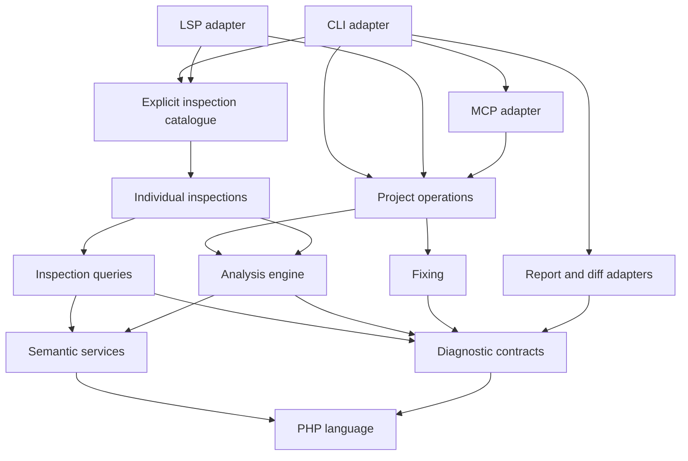

# Architecture

custos is one Go module. Core analysis uses the standard library. The MCP adapter uses the official Go
MCP SDK pinned in `go.mod`; Windows storage ACL checks use `golang.org/x/sys`. Feature
roots separate language processing, semantics, inspections, project operations
and adapters. `cmd/custos` only passes process arguments and streams to the CLI.

## Ownership

This table is the canonical package map; the `AGENTS.md` files in each root
summarize the same responsibilities.

| Root | Responsibilities |
|---|---|
| `internal/php` | `syntax`: lexer, parser, arena AST, traversal and positions; `version`: PHP 5.3–8.5; `phpdoc`: doc tags and type expressions. |
| `internal/semantic` | `names`, `types`, `index`, `infer` and embedded `stubs`: resolution, declarations, inheritance, inference and narrowing. |
| `internal/semantic/flow` | Bounded file-local value and state analysis (possible values, origins, integer ranges, receiver state) and immutable project-local callable summaries, exposed through `Context.Flow()`. |
| `internal/inspection` | `analysis`: dispatch, context and suppressions; `meta`: independent rule facts and descriptions; `catalogue`: explicit constructors; `rules`: one package per lowercase inspection ID. |
| `internal/inspection/astquery` | Lexical queries over nodes and tokens, plus exact source-edit builders. Written names do not imply resolved symbols. |
| `internal/inspection/flowquery` | Local reachability, assignments, variable accesses, side effects and possible values. |
| `internal/inspection/semanticquery` | Resolved calls, classes, hierarchies, types, native-function contracts and inspection fix decisions. |
| `internal/inspection/phpunit` | Shared assertion-call shapes, method spelling and PHPUnit version detection. |
| `internal/diagnostic` | Severity, findings, lazy fixes, edits, file results and positioned items. |
| `internal/fixing` | Conflict detection, edit application and bounded iterative fixing. |
| `internal/project` | Discovery, bounded reading, indexing and flow snapshots, buffer analysis, project reporting and prepared file fixes; `config` and `baseline` subpackages. |
| `internal/output` | `report` renders text, JSON, Checkstyle, GitHub and SARIF; `diff` renders changes. |
| `internal/cli` | Arguments, configuration precedence, profiling, output, exit codes and file writes. |
| `internal/editor/mcp` | MCP tools, transports, authorization, checkpoints, prepared plan lifecycle and confined writes. |
| `internal/editor/lsp` | Transport dispatch, settings, workspace indexing, documents, diagnostics and code actions. |
| `internal/platform/safeio` | Bounded filesystem primitives. |
| `internal/testing` | Conformance harness and load-scaled test budgets. |
| `tools` | Generators, architecture enforcement, coverage and clean-room checks. |

## Execution and contracts

`project.Open` receives resolved options and an explicit inspection list. It
builds an engine and discovers PHP files plus enabled inspections' file patterns.
`AnalyzeReport` indexes project and vendor declarations when needed, reuses
source bytes and removes edit closures while retaining fix titles.
`PrepareFixes` computes deterministic outcomes without writing files. CLI owns
diffs, writes and exit decisions. `AnalyzeBuffer` processes supplied editor
bytes without filesystem reads.

`catalogue.All` constructs inspections in the original group order, sorted by
ID within each group. Categories are metadata. The engine subscribes
inspections by node kind and walks each parsed file once. Names, symbols,
types, flow environments and memoized queries are lazy per-file context data.
An inspection implementing `analysis.SemanticRule` makes the runner build the
project index first; one implementing `analysis.FlowRule` requests
project-local callable summaries.

`Engine.WithIndex` and `Engine.WithFlow` return configured copies; published
engines are never reconfigured in place. Project indexes are built in memory.
The LSP builds its workspace index in the background and publishes
replacement engines while holding its server mutex. Keep shared declarations immutable during
context-dependent member lookup.

Source positions remain `uint32` byte offsets; diagnostic items use rune
columns and LSP uses UTF-16 columns.

A `diagnostic.Fix` builds exact edits lazily. Fixing depends on an `Analyzer`
interface returning findings for a parsed file. It selects one fix per finding,
keeps multi-edit fixes together, rejects ambiguous insertion conflicts and
iterates at most ten times. Single-pass mode preserves editor/conformance
semantics. Rule implementations decide whether a proposed fix is safe.

## Inspection helpers

Each inspection exposes `New() analysis.Rule`; its implementation type and
private helpers stay in its package. Keep a helper there until another
inspection needs it, then choose its owner by behavior:

- `astquery` for lexical AST and token queries and edit builders;
- `flowquery` for local reachability, assignments and possible values (its
  package comment states the completeness contract);
- `semanticquery` for resolved symbols, types and native-function contracts.
  Operation histories (`semanticquery.CallHistory`) separate mandatory from
  possible predecessors; their doc comments define when a history proves
  absence.

### Guards are narrowing questions

A rule that needs "this value was tested on the way here" asks the native
environment (`Env.Native()`) for the narrowed type instead of walking the
enclosing branches, ternaries, short-circuit operands and early exits itself.
The engine already handles chains, negations, saved results, loops and the
writes, calls and references that end a fact.

- For a read, use `TypeOf`, or `NarrowedFrom(x, seed)` when the rule models
  values the declaration cannot express. Seeds can carry int values
  (`types.Ints`), string lengths (`types.StringLengths`), enum cases
  (`types.EnumCases`) and string values (`types.TrackedStrings`). These
  facts exist only where a caller seeds them, so ordinary inference never
  pays for them.
- For a place that does not read the value, use `NarrowedVarAt` (locals) or
  `NarrowedMemberAt` (properties and elements).
- For the result of one call or comparison node, use `CallResultAt` or
  `CallResultAsAt`. In `semanticquery`, `NativeEarlierCallProves` scans the
  earlier calls of the scope, and `NativeCallSucceeded` and
  `NativeNarrowedExcludes` cover the common cases.

An unknown result from a known seed means the place is unreachable, or that
the analysis gave up (dynamic writes, budgets). Treat it as proof only to
withhold a finding, never to raise one. Where a `goto` label may let a jump
bypass a guard, `semanticquery.NativeLabelled` says so, and the guard proves
nothing.

Constant string consumers can use `syntax.LiteralStringValue` for decoded
quoted strings, heredocs and nowdocs. `syntax.DecodeLiteralString` additionally
maps each decoded byte to its original source span, including entire escape
sequences and indentation removal. Request that mapping only when source
positions are needed; quoted-string helpers retain their narrower contracts.

`flowquery.MethodReceiverEffect` describes a possible receiver mutation through
member accesses and fluent chains. Its conditional flag records nullsafe
accesses; a possible mutation is never proof that a write occurred.
`Flow().ParameterRead` uses CFG results to ask whether a parameter's entry
value is read. Only a known negative result proves that value unused; unknown
values and incomplete scopes stay conservative. Captures are observed when the
closure is created; arrow parameter names shadow outer names. Scope introspection
observes the possible current parameter bindings at the call's execution point.

PHPUnit declaration metadata, call and version support belongs in `phpunit`. Preserve the
difference between a written call name and its actual runtime target,
especially when deciding whether a fix is safe.

## Semantic evidence and fix safety

`infer.Env.BuiltinArguments` resolves a native function and returns source
expressions in parameter order. It validates the entire call, including PHP
version rules, duplicate bindings and bounded literal argument packs; unknown
or variadic bindings establish no value or omission proof. Use this when a rule
needs runtime argument roles rather than their written positions. Nested literal
packs are expanded with depth and entry budgets; numeric keys are renumbered on
array spread, and string keys follow the configured PHP version's overwrite rules.
`types.Type.ArrayCardinality` supplies lower and upper bounds from sealed,
array-only types and explicit finite bounds independent of key identities.
Key-changing operations derive new bounds; mutation drops them. Normal
`count()` and `sizeof()` calls can use those bounds. Constant slice offsets and
lengths refine the bounds; proven zero-entry alternatives contribute no element
widening in unions. Recursive counts require separate evidence. A quick-fix needing runtime cardinality uses native
inference and requires equal bounds; documented shapes alone cannot authorize the edit.

A written name is not enough to identify a builtin. Use the analysis context's
resolved global-function queries so namespace functions and imports retain
PHP's runtime behavior. Function, method and class names are case-insensitive;
variables, properties and ordinary constants are case-sensitive.

Pick the narrowest query that says what the check needs:

- `semanticquery.NativeBuiltin` / `NativeBuiltinName`: the call reaches a
  builtin available at the configured PHP version. The default for rules
  about PHP's own functions.
- `semanticquery.GlobalCall`: an expression that is a call to one of several
  global functions, with the matched name.
- `ctx.GlobalFunctionName` / `ctx.IsGlobalFunctionCall`: the global function
  a call reaches, whether or not PHP still declares it at that version (for
  removed or polyfilled functions).
- `semanticquery.QualifiedBuiltin` / `QualifiedBuiltinFor`: the name a fix
  must write so that its call still reaches the builtin.
- `astquery.IsFuncNamedFold` / `CallName`: the written name only, for
  syntax-level heuristics that do not claim runtime behavior.

PHPDoc supplies useful analysis evidence, but it does not enforce runtime types.
When a fix requires native type evidence, use `Env.Native()` to exclude user
PHPDoc. Unsupported operations, escaped values and exhausted analysis budgets
must discard definite facts rather than authorize a finding or fix.

## Flow and project summaries

Published call histories preserve source order. Their node index is rebuilt after
sorting so argument and sink queries can look up calls directly, including calls
whose evaluation order differs from source order.

Flow queries track reachable assignments, branch guards, object and resource
identities and context-specific validation, and distinguish an unchecked read
result from one rejected by a strict failure check. Project analysis builds
summaries for resolved project functions and methods so supported wrappers
carry return values and unsafe uses across files; the LSP updates them for
open documents.

- Sink summaries keep array values apart from keys. Numeric values stay safe
  for text-injection contexts when a wrapper uses only those values; keys and
  whole-array formatting keep their input provenance. Numeric content alone
  never validates file paths or network destinations.
- A method wrapper needs a final receiver class, a final method or an
  accessible private method, with one unconditional declaration. Overridable
  methods stay conservative. A native receiver union of at most eight
  classes may instead join return contracts and possible sinks when each target
  is non-overridable (a final class, a final method or an accessible private
  method) and every target, declaration chain and argument binding is known. PHPDoc-only unions,
  escaped receivers, missing targets, generators and reference bindings do not
  establish that proof. Each class-metadata and callable contract participates
  in the cross-file dependency graph.
- Locally created closures and arrows use bounded invocation frames with
  argument values and by-value capture snapshots. Caller-specific bindings never
  replace the ordinary symbolic scope cache or enter project snapshots. Reference
  captures/parameters, generators, static state, escaped values and ambiguous
  callees remain conservative. Supplied optional arguments are bound directly;
  omitted defaults require supported pure primitive values. Variadics retain
  bounded individual entries. Invocation work is charged to the caller's budget
  and incomplete status propagates to it.
- First-class project-function references and known project callbacks passed to
  `call_user_func` or `call_user_func_array` reuse complete callable summaries and
  binding proofs. Native function targets reuse native contracts. Closed method callbacks and
  invokable objects require native receiver evidence and non-overridable visible
  targets. Complete finite alternatives join all targets, including literal
  callable names; unsupported alternatives establish no proof.
- Finite `array_map` inputs evaluate supported callback contracts per element.
  One input preserves literal keys; up to eight complete inputs with proven
  insertion order bind positional values, pad shorter inputs with null and use
  numeric output keys. Proven sealed argument packs use the runtime-role binder;
  an unpacked pack must retain every entry, independently of its native shape.
  A null callback keeps one input or zips several inputs into numeric rows.
  Immutable nested element provenance crosses local
  invocation frames and bounded syntax-free return templates. Callback effects do not establish caller operation
  facts or execution-order proofs. Unknown inputs and unsupported bindings use
  conservative aggregate provenance.
- Named and returned callbacks can publish bounded syntax-free primitive return
  expressions, literal defaults and immutable captured parameter slots. Resolved
  pure wrapper calls compose these contracts; evaluation checks discarded local
  assignments too. Invocation binding uses call-site strictness, while return
  conversion uses definition strictness. Recursion, uncertain conversions and
  exhausted work limits retain unknown results. Scalar evaluation refines
  provenance separately; exact record forwarding additionally proves caller
  resource identities and preserves field aliases.
- Pure callback contracts also encode bounded conditional returns, ternaries,
  short-circuit boolean operations and null coalescing. Only the selected operand
  is evaluated. Audited native `strlen` and default `trim` calls require proven
  strings. Immutable literal-array defaults and known-key projections preserve
  field provenance, with canonical PHP integer-key normalization and no
  warning-producing key conversions; structural refinement rejects observable object/resource
  inputs. Compiled wrapper spreads reuse the runtime argument-role binder.
- Pure summaries also resolve the audited native `COUNT_NORMAL` constant and
  PHP 8 byte-string prefix, suffix and containment predicates. Strict membership
  can use an empty array or a decisive matching scalar entry, while unknown
  entries establish no absence proof. Bounded immutable array spreads follow
  version-specific key rules. Empty array accumulators with one append-only
  foreach update preserve insertion order and individual element provenance;
  aliases and observable object or resource lifetimes remain unsupported.
- Supported accumulator loops can feed one final pure expression over the carry
  and unchanged entry bindings; loop key/value variables establish no post-loop
  binding. Append-only loops can filter by a proven per-entry pure condition.
  Ordered native array queries preserve individual elements and exact key types;
  primitive type predicates require scalar or immutable record evidence. Bounded
  byte slices use PHP-version range behavior, retain input provenance and clear
  escaping proofs. Unknown conditions and unsupported conversions stay unknown.
- Callback truth outcomes are separate from literal equality. Each normal return,
  including implicit null, is converted before joining truth outcomes. Agreeing
  falsy returns can remove entries without treating different literals as equal.
- Finite `array_filter` inputs reuse callback binding and sink contracts in
  value, key or combined mode. Retained entries keep their original provenance;
  predicate results never act as transformations. Unknown truth keeps possible
  entries without establishing complete output membership. Mutable entry values
  establish no output-field proof.
- Returned closure contracts contain only parameter metadata, symbolic values,
  bounded nested shape templates and sinks. Capture-free closures and immutable by-value captures can cross
  project boundaries; references, mutable captures, generators and static state
  cannot. Each caller supplies its own factory argument snapshots.
- Indirect native closes remain pending until the exact result is proven true.
  Fixed quiet wrappers returning an unchanged close result reuse that relation,
  including supported wrapper chains and closed method calls. Scalar return
  coercions establish no such boolean identity proof.
  Saved results retain that proof only while the pending operation is current;
  failure branches, later operations and escapes establish no close proof.
- Closure invocation frames copy operation states. A returned fresh resource gets
  a caller identity; a borrowed identity preserves the existing caller state.
  Only states shared by normal completions are projected, and a newly observed
  close requires proven success. Other callee-local identities are dropped.
- `Flow().ReferenceResult` also projects reference outputs from a proven
  final or private method. Nullable, escaped and PHPDoc-only receivers do not
  establish that replacement proof. Multiple reference outputs require distinct,
  unaliased local cells; globals, static locals and element lvalues remain unknown.
- Fixed quiet wrappers project common `fread`, `fwrite` and checked-close states
  onto proven borrowed resources. Escapes, repeated actual handle identities,
  reference parameters and variadics establish no effect proof.
- Catch paths are pruned only for blocks proven non-throwing. Calls, uncertain
  reads or writes, callbacks and object destruction keep exception paths;
  `finally` blocks follow the applicable exits. `declare(ticks=…)` disables
  pruning for the whole file.
- Ambiguous declarations, escaped resources, unsupported operations, recursion
  and exhausted budgets discard definite facts: an unknown result is never
  proof of a bug.

Nested element facts have bounded depth and branching cost even when loops wrap an
earlier array. Exhaustion discards field detail while retaining aggregate
provenance. Return templates use a deterministic budget for the whole tree.
Whole-entry completeness and insertion order are separate from value completeness;
losing an entry invalidates complete-pack and exact-cardinality proofs. Optional
filter entries retain all possible values for single-input mapping but establish
no exact argument-pack or multi-input positional proof. Scalar
coercions and predicates discard operand array shapes. Compact templates are
immutable: unchanged subtrees and empty sets are shared, while changed fields
trigger a map copy. Predicate literals are retained only when declared parameter or return
conversion cannot change their scalar kind.

Expression values use small, lazily allocated blocks behind per-scope indices;
queries still return value copies. Branch bindings retain copy-on-write maps
whose immutable value cells remain shared when a map is cloned. Writes replace
shared cells; cells still private to one frame can be updated in place.
Lookups return value copies. Recording an unchanged fact keeps the
existing map shared. Class identity
keys may be cached, but each contract use must still record its dependency.
Summarization reuses its declaration inventory for local producer queries.
Resolved member declaration metadata is cached per call site, index identity
and revision, and PHP version. Unresolved lookups remain eligible for later
inference. Keep live receiver, visibility and contract dependency proofs at
each use.
Terminal native-value queries may skip discovery only when they produce the
same candidate as the full discovery procedure; properties, constants and
conditional alternatives keep their existing resolution path.

### Assertions

By default `assert()` establishes no guard: on PHP 7+ its arguments may be
skipped, so assignments and sanitizers inside them prove nothing. With
`flow.assertions: true`, direct `assert` calls are assumed to run and to
terminate on failure, in inference, project summaries and the LSP (which
rebuilds dependent summaries when the setting changes). Before PHP 8 a string
assertion can execute code, so a string — or any argument not syntactically
known to be non-string — invalidates local proofs; native type predicates and
strict comparisons stay usable. From PHP 8 a plain variable assertion may also
supply a guard.

File-query environments inventory local declarations without following bodies.
They mask the indexed version of the buffer immediately and compute demanded
contracts and their dependencies in isolated workers. Acyclic dependencies need
one pass; recursive closures replay in declaration order when discovery did not
already start at their first declaration. A bounded discovery budget ensures
inspection query order cannot change their contracts. Stable contracts
remain private to the environment, and only scopes whose recorded answers still
match are reused. Workers share completed global facts, pure metadata caches and
the file-local resource-identity registry; active scopes are never borrowed.
Rebasing a query environment rebuilds its local cache. Project
snapshot publication remains exhaustive through `Summarize`. Deferred worker
failures run inside the context's shared flow-data guard, so they do not disable
the inspection that happened to request the contract.

## Analysis status

Analysis gaps are reported as status reasons instead of findings:

- inference: `argument-budget`, `inference-budget`, `inference-recursion`;
- flow: `unresolved-dispatch` (no flow contract for a call), `dynamic-code`,
  `unsupported-control-flow`, `flow-budget`, and `status-limit` when the
  per-file gap list is bounded;
- `semanticquery` helpers: `query-budget` (`ctx.Gap`);
- engine: `syntax-recovery`, `finding-limit`, `rule-failure`, and
  `internal-failure` when building data rules share (names, symbols, types,
  flow) crashed; `io-error` from `diagnostic.Status`; `project.AnalyzeBuffer`
  and LSP guarded analysis: `internal-failure`.

The LSP discards results from an older document version, a reopened document
or a replaced engine before publishing diagnostics or status. Lazy fixes are
tied to the analysis that produced them and are rechecked before returning
edits. Status log messages are sent only when a document's reasons change.

## Bounded analysis and input

Repository content and editor buffers are untrusted input. Preserve bounds on
source size, syntax nesting, findings, PHPDoc parsing and expansion, hierarchy
traversal and local-flow work. When adding a traversal, account for cycles and
repeated queries as well as recursion depth; cache reusable scope queries and
fall back conservatively when a budget is exhausted.

Filesystem reads belong to bounded `safeio` operations, which require regular
files and check the opened descriptor as well as the path. Adapters retain
responsibility for writes, path validation and protocol framing. Malformed or
oversized input must produce a controlled error rather than hang or panic.

A crash on one file must not end the process or other files' results. Work
fanned out per file goes through the `project` worker pool, which recovers
panics on its goroutines; `AnalyzeBuffer` turns a crash outside any rule into
an `internal-failure` result, and `fixing.Edits` computes a lazy fix's edits
under recovery. Cross-file flow composition discovers dependencies, groups
recursive files, and processes dependency groups before their readers.
Graph rediscovery and per-file summarization are bounded; summaries still
unsettled after those limits are dropped, so calls into those files read as
unresolved rather than as clean.

Use hostile-input regression tests and fuzz targets for these contracts.
Measure hot-path changes with `make bench` and allocation counts.

## Dependency enforcement

`make architecture`, included in `make verify`, checks production imports,
forbids cross-inspection dependencies and validates catalogue completeness,
unique registration, lowercase ID directories, constructors, specs and fixtures.
PHP, semantic, diagnostic, analysis and fixing packages cannot depend on CLI,
LSP, reporting, project orchestration or filesystem adapters. The MCP adapter
may use project operations, fixing, analysis contracts, rule metadata, the
diff renderer and `safeio`, but not the catalogue or the report formats: the
CLI hands it the inspection list. Those analysis packages cannot import the
standard packages that reach the system (`os`, `os/...`, `syscall`, `net`,
`net/http`): what a rule needs from outside the source, such as the project
root of a file (`Context.ProjectPath`), comes from the adapter through the
analysis configuration. A package missing from the tool's table may import
nothing internal until it is added there. An exported `semanticquery`
declaration that a single inspection uses is reported: it belongs in that
inspection's package. Test imports may cross boundaries
to exercise complete execution paths.

## Extending features

- Add an inspection in its ID package with its spec and fixtures, then one
  constructor in the catalogue; see [Adding a rule](./adding-a-rule).
- Improve inference in `semantic/infer`, with tests there. Environment,
  expressions, operators, calls, members, variables, conditions, guards and
  invalidation have separate files in the same package and share existing caches.
- Add a fix to its inspection using diagnostic edits. Generic conflict/application
  changes belong in `fixing`; project preparation and adapter writes stay separate.
- Add an output adapter in `output/report` using positioned diagnostic items.
  Core analysis and baselines do not depend on reporting.
- Extend syntax in `php/syntax`, then regenerate node kinds with
  `go generate ./internal/php/syntax` and verify all PHP versions. Keep arena
  ownership, parser recovery and exact spans intact.

## Generated files

`make rules-doc` regenerates `inspection/meta/descriptions.json`
(`tools/genexplain`), the public rule reference and sidebar
(`tools/rulesref`) and the internal status table (`tools/rulesdoc`). They
read specs through `tools/internal/specmd`, which also makes spec text
readable for users (see [Adding a rule](./adding-a-rule#_1-the-spec)).
`make stubs` rebuilds embedded semantic assets; rerun it whenever a change to
symbol extraction or annotation resolution alters the stub data, and bump the
index revision that `tools/genstubs` records in `VERSION`. Specifications and
inspection fixtures remain ID-based.
